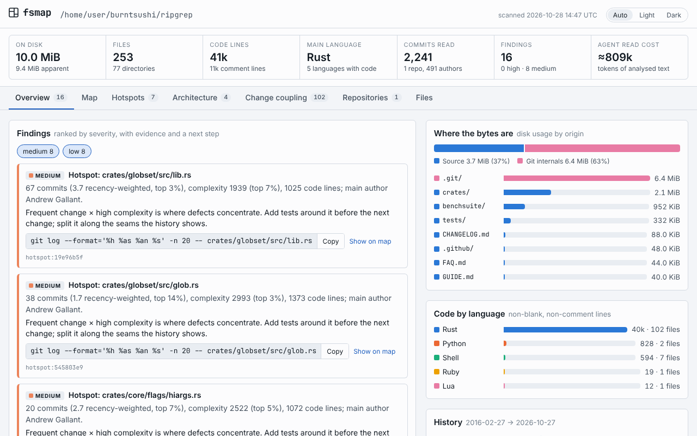
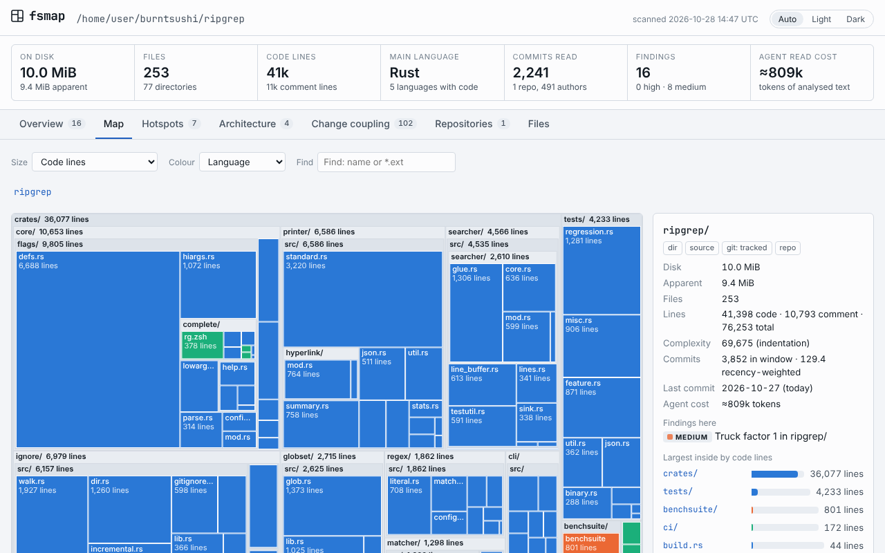

# fsmap

**Map any directory — a repository, a home folder, a server disk — into one picture of
what is there, how it got there, and what deserves attention.** One Rust binary; outputs
for humans (interactive HTML), AI agents (budgeted Markdown, hooks) and CI (SARIF, exit codes).
For Rust repositories it also puts the compiler and tests into an AI agent's loop: a
verification gate and Claude Code hooks ([agent harness](docs/agent-harness.md)).

> **한국어 요약** — 파일시스템 전체(디스크 용량·빌드 산출물·중복)와 코드베이스(언어·의존성·순환·git 이력 기반
> 핫스팟·소유권·같이 바뀌는 파일)를 하나의 지도로 합쳐 보여주는 Rust CLI입니다. 사람용 HTML 리포트, AI 에이전트용
> 컨텍스트/훅, CI용 래칫을 함께 제공합니다. Rust 저장소에서는 AI 에이전트의 작업 루프에 컴파일러·테스트
> 게이트를 거는 하네스(`fsmap verify`, Claude Code 훅)도 됩니다. 만든 배경과 Rust × AI 활용 가이드는
> [docs/rust-ai-playbook.md](docs/rust-ai-playbook.md)에 있습니다.



## What it answers

| Question | Command |
|---|---|
| Where did my disk go, and what of it can I safely rebuild? | `fsmap report ~ --sizes-only` |
| What does this codebase look like — languages, layers, cycles, hotspots, owners? | `fsmap report .` |
| What should an AI agent know before it starts? | `fsmap context . > REPO_MAP.md` |
| I changed A — which files usually change with A that I forgot? | `fsmap brief --diff` |
| Fail CI only when something *new* goes wrong (a cycle, a committed `dist/`, a secret-looking file)? | `fsmap insights . --baseline b.json --fail-on medium` |
| What grew since last week? | `fsmap diff old.json new.json` |
| Which paths should agents not waste tokens on? | `fsmap agent-ignore .` |

What makes it different from `dust`/`ncdu` (disk), `tokei`/`scc` (code), `code-maat`
(history), or `madge` (imports) is that **one snapshot joins all of them**. That makes
findings possible that no single tool can produce:

- "62 % of this repo's footprint is git-ignored build output";
- "a 300 MB binary is tracked";
- "these two files change together in 80 % of commits but neither imports the other";
- "this file is imported by 40 others and nobody who wrote it is still active".

## Install

```bash
cargo install --locked --git https://github.com/d-j-lee/filesystemMap fsmap
```

Or build from a checkout with `cargo build --release` (Rust ≥ 1.89). The binary is
`target/release/fsmap`. `git` on `PATH` enables history features; everything else works without it.

## Quick start

```bash
fsmap report .            # writes fsmap-report.html and prints a summary
fsmap report . --open     # …and opens it
```

The report is a single offline HTML file. It loads nothing from the network, so you can attach
it to a ticket. Its tabs:

- **Overview**: findings, where the bytes are, code by language, history.
- **Map**: zoomable treemap; size by disk, apparent size, files, code lines or LLM tokens;
  colour by origin, kind, language, git state, age, hotspot or author; search.
- **Hotspots**: change × complexity scatter and ranking.
- **Architecture**: dependency matrix per directory, cycles with the cheapest cut, most-imported
  files.
- **Change coupling**, **Repositories** (every work tree found, with local-only work), and
  **Files**.



## Commands

| Command | Output |
|---|---|
| `report [PATH] [-o FILE] [--open]` | Interactive HTML + terminal summary |
| `scan [PATH] [-o FILE] [--pretty]` | JSON snapshot ([schema](docs/snapshot-schema.md)), unpruned unless `--max-nodes` |
| `context [PATH] [--budget N]` | Deterministic Markdown repo map for agents |
| `insights [PATH] [--format text\|json\|sarif\|markdown] [--fail-on SEV] [--baseline F] [--write-baseline F]` | Findings; exit 1 when a (new) finding ≥ SEV |
| `brief [FILES…] [--diff [BASE]] [--hook] [--root DIR] [--refresh]` | Pre/post-edit briefing; forgotten co-change partners; Claude Code hook protocol. The index is cached per repository and HEAD |
| `diff OLD.json NEW.json [--top N]` | Growth, new large files, new/resolved findings |
| `verify [PATH] [--mode quick\|full] [--strict] [--json] [--timeout S]` | Rust gate: settings that weaken it, fmt, clippy `-D warnings`, tests, the repository's extra steps, cargo-deny in `full`. Exit 1 on failure, 2 when it cannot run |
| `hook session-start\|post-edit\|stop\|prompt\|pre-bash\|stats` | Claude Code hooks for the [agent harness](docs/agent-harness.md); `stats` summarises their log |
| `agent-ignore [PATH] [--format claude\|gitignore]` | Read-deny rules for dependency, build-output and vendored directories; `gitignore` format adds reasons and token costs |

Common analysis flags:

| Flag | Effect |
|---|---|
| `--sizes-only` | du speed: no git, no file reads |
| `--no-git`, `--no-deps`, `--no-dupes` | Skip that stage |
| `--since 2y\|18m\|6w\|90d\|all\|YYYY-MM-DD` | History window: a duration counts back from each repo's newest commit; a date is absolute |
| `--git-max-commits N`, `--max-repos N` | Safety caps: commits read per repository (30 000), repositories analysed (64) |
| `--max-file-mib N` | Larger files are not read (default 4) |
| `--exclude GLOB` | Skip paths |
| `--cross-fs` | Descend into other mounts |
| `--authors names\|hashed\|none` | Author identities in outputs; emails are never output |
| `--max-nodes N` | `report`/`scan`: fold the tree to this many nodes (report default 60 000); totals stay exact |
| `--no-csp` | `report`: omit the Content-Security-Policy tag, for hosts that inject scripts |
| `-j N`, `-q` | Worker threads; no progress display |

Exit codes: `0` ok, `1` findings at or above `--fail-on` or a failing `verify`, `2` error.
The event hooks (`hook session-start` … `hook pre-bash`) always exit `0` and report problems in
their JSON answer.

## What the numbers mean

The definitions are short and in [ARCHITECTURE.md §5](docs/ARCHITECTURE.md#5-scoring-definitions):

- **Hotspot**: recency-weighted change × indentation complexity, both as percentiles.
- **Change coupling**: directional confidence and lift.
- **Authorship**: degree-of-authorship and truck factor.
- **Cycles**: computed on the lifted sibling graph, with deferred and type-only imports excluded.

Import resolution is heuristic: regex extraction plus real resolution rules per ecosystem. The
report states internal vs external counts per language, so you can judge coverage.

## AI agents and CI

See [docs/ai-agents.md](docs/ai-agents.md):

- a repo map in `CLAUDE.md`;
- a PostToolUse hook that tells the agent which files usually change with the one it just edited;
- read-deny rules;
- a baseline ratchet with SARIF output for GitHub code scanning.

For Rust repositories, [docs/agent-harness.md](docs/agent-harness.md) adds the verification
layer: `cargo check` after each edit, `fsmap verify` before a turn ends or a push, and checks
that catch an agent weakening the gate to get green.

## Documentation

| Document | Contents |
|---|---|
| [ARCHITECTURE.md](docs/ARCHITECTURE.md) | Pipeline, model, scoring, performance, safety |
| [decisions.md](docs/decisions.md) | Decision log with alternatives and costs |
| [snapshot-schema.md](docs/snapshot-schema.md) | JSON contract `fsmap/1` |
| [ai-agents.md](docs/ai-agents.md) | Context, hooks, agent-ignore, CI ratchet |
| [agent-harness.md](docs/agent-harness.md) | Verification gate and Claude Code hooks for Rust repositories |
| [ROADMAP.md](docs/ROADMAP.md) | Seeds: MCP server, cache, WASM, Chromium profile… |
| [rust-ai-playbook.md](docs/rust-ai-playbook.md) | (한국어) Rust × AI adoption guide, with this repo as the worked example |
| [research/](docs/research/) | Dated evidence behind the playbook |
